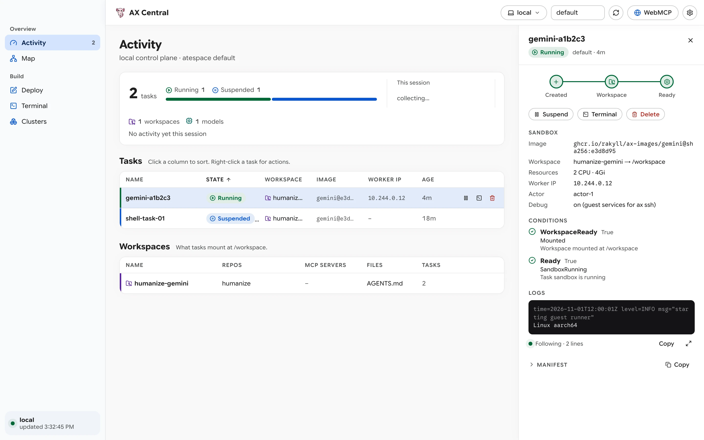
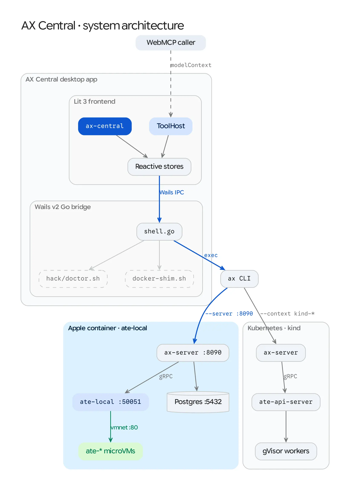
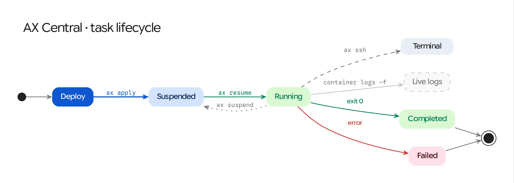
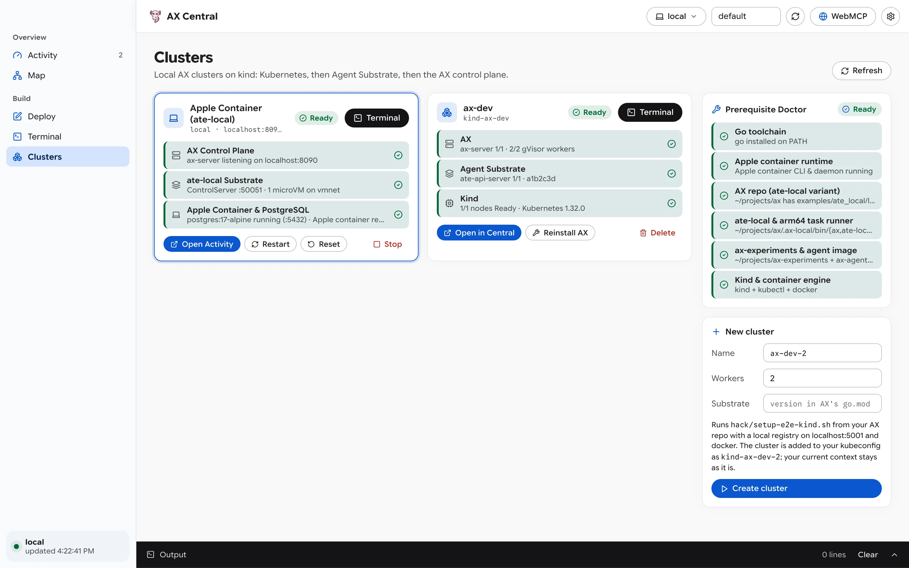

# AX Central

[](LICENSE)
[](CHANGELOG.md)
[](go.mod)
[](docs/reference/cli-and-webmcp-tools.md)

A native macOS desktop control plane for [AX](https://github.com/google/ax) and [Agent Substrate](https://github.com/agent-substrate/substrate) that lets you design tasks, watch them run, stream container and Kubernetes logs, open interactive `ax ssh` terminals, manage local Apple `container` (`ate-local`) stacks and `kind` clusters, and expose 16 AX operations as WebMCP (`document.modelContext`) tools.

Built with [Wails v2](https://wails.io/) (Go) and [Lit 3](https://lit.dev/) WebComponents (TypeScript, Luminous 0.15–0.19 design tokens).

<picture>
  <source media="(prefers-color-scheme: dark)" srcset="docs/screenshots/activity-dark.webp">
  
</picture>

## Contents

- [Install](#install)
- [Quickstart](#quickstart)
- [Architecture](#architecture)
- [Views and Capabilities](#views-and-capabilities)
- [Documentation (Diátaxis)](#documentation-diátaxis)
- [Local Development Setup](#local-development-setup)
- [Release and Packaging](#release-and-packaging)
- [Troubleshooting](#troubleshooting)
- [Contributing](#contributing)
- [License](#license)

## Install

Clone the repository, audit prerequisites with `make doctor`, and build the native macOS `.app` bundle:

```bash
git clone https://github.com/ghchinoy/ax-central.git
cd ax-central

# Audit Go, Apple container, ~/projects/ax (ate-local variant), ~/projects/ax-experiments, and kind
make doctor

# Automatically clone/build any missing Tier-A (ate-local & ax-experiments) prerequisites
make bootstrap

# Build and launch the native macOS application bundle
make wails-build && open "build/bin/AX Central.app"
```

## Quickstart

Run a full end-to-end `debian:12` microVM task on the local Apple `container` (`ate-local`) stack from the CLI or UI in under 10 seconds:

```bash
# Headless CLI smoke test: starts ate-local (:50051) + ax-server (:8090),
# applies a debian:12 task, resumes the microVM, runs `ax ssh -- uname -sm`, and cleans up
make smoke-local
```

Inside **AX Central.app**:

1. **Start the local stack (`⌘5`)**: Open **Clusters**, click **Start** on the **Apple Container (`ate-local`)** card (~3.3s startup), and click **Open in Central** to target `local` (`localhost:8090`).
2. **Create a task (`⌘3`)**: Open **Deploy**, choose **`Apple Container (ate-local)`** from the **Templates** menu, and click **Create** (`⌘↩`).
3. **Resume and inspect (`⌘1`)**: Open **Activity**, click **Resume (`▶`)** on the task row (~0.7s microVM boot), and click the row to inspect live `container logs -f` output in the **Task Inspector**.
4. **Open a shell (`⌘4`)**: Click **Terminal** in the inspector (or press `⌘4`) to open an interactive `ax ssh` session (`192.168.64.x:80`) or launch it in `/Applications/Ghostty.app`.

For the complete step-by-step walkthrough with screenshots, read **[Tutorial: Run Your First Local Task in AX Central](docs/tutorials/quickstart-local-stack.md)**.

## Architecture

AX Central bridges Lit 3 reactive stores (`store.ts`, `designer.ts`, `clusters.ts`) and WebMCP (`ToolHost`) to a Go subprocess and streaming runner (`shell.go`) that talks to either the 3-second macOS Apple `container` stack (`ate-local`) or a local Kubernetes `kind` cluster (`gVisor` WorkerPool).

<picture>
  <source media="(prefers-color-scheme: dark)" srcset="docs/diagrams/01-architecture-dark.webp">
  
</picture>

<picture>
  <source media="(prefers-color-scheme: dark)" srcset="docs/diagrams/02-task-lifecycle-dark.webp">
  
</picture>

## Views and Capabilities

| View | Element | Capabilities |
| :--- | :--- | :--- |
| **Activity** (`⌘1`) | `<ax-overview>`, `<ax-task-inspector>`, `<ax-task-logs>` | Atespace digest card, session SVG phase sparkline, sortable Tasks and Workspaces tables, and slide-in Task Inspector with streaming `container logs -f` (`local`) and `kubectl logs -l ate.dev/worker-pool` (`kind`). |
| **Map** (`⌘2`) | `<ax-topology>` | Interactive zoomable SVG Bezier graph connecting Git repositories, inline files, and MCP servers to Workspaces and Tasks. |
| **Deploy** (`⌘3`) | `<ax-designer>` | Split-pane visual form, live Composition Diagram, and unified read-only / raw YAML editor with `ax-images` and `ax-experiments` templates (`ate-local`, `genkit-apple-container`, `swarm-reviewer`) and STDIO MCP security checks. |
| **Terminal** (`⌘4`) | `<ax-terminal>`, `<ax-terminal-session>` | Multi-tab interactive `ax ssh` sessions powered by `TerminalBackend` (`script(1)` PTY and `AXS-LINE-MODE` fallback) plus one-click launch in native `Ghostty.app`. |
| **Clusters** (`⌘5`) | `<ax-clusters>` | Apple Container (`ate-local`) 3-layer stack card, Kind cluster provisioning (`hack/setup-e2e-kind.sh` with Podman `docker-shim.sh`), and the in-app **Prerequisite Doctor** with streaming bootstrap repair. |
| **WebMCP** (`⌘I`) | `<ax-webmcp-drawer>` | Registers 16 AX tools with `document.modelContext` (and the in-app fallback registry), with live call history, group toggles, and an interactive tool runner. |

<picture>
  <source media="(prefers-color-scheme: dark)" srcset="docs/screenshots/clusters-dark.webp">
  
</picture>

## Documentation (Diátaxis)

Full documentation lives under [`docs/`](docs/index.md), organized into the four [Diátaxis](https://diataxis.fr/) quadrants:

* **Tutorials (Learning-Oriented)**
  * [Run Your First Local Task in AX Central](docs/tutorials/quickstart-local-stack.md)
* **How-To Guides (Task-Oriented)**
  * [Manage Runtimes, Prerequisites, and Clusters](docs/how-to/manage-runtimes-and-clusters.md)
  * [Design Tasks and Automate with WebMCP](docs/how-to/design-tasks-and-use-webmcp.md)
* **Reference (Information-Oriented)**
  * [CLI, Shortcuts, and WebMCP Tools Reference](docs/reference/cli-and-webmcp-tools.md)
* **Explanation (Understanding-Oriented)**
  * [System Architecture and Dual-Substrate Design](docs/explanation/architecture.md)

## Local Development Setup

### Prerequisites
* **macOS** (`darwin/arm64` recommended for Apple `container` microVMs)
* **Go** `1.25+` and **Wails CLI** `v2.13+` (`go install github.com/wailsapp/wails/v2/cmd/wails@latest`)
* **Node.js** `22.23.4+` and `npm`
* **Apple `container` CLI** (`/usr/local/bin/container`, `brew install --cask container && container system start`) for Tier-A local stack, or **Podman / Docker + `kind` + `kubectl`** for Tier-B Kubernetes clusters
* **Optional (diagrams & screenshots)**: `graphviz` (`dot`, `gvpr`) and `webp` (`cwebp`) via `brew install graphviz webp`

### Development Commands
```bash
# Install frontend dependencies and start Wails live-reload dev session
make dev

# Run all quality gates: gofmt, go vet, golangci-lint, bash -n, tsc, prettier,
# npm audit, Go race tests, and Vitest headless Chromium + axe-core WCAG 2.1 AA tests
make check

# Re-render Luminous Graphviz diagrams and retina WebP screenshots
make diagrams
make screenshots
```

**Default local stack ports:** PostgreSQL (`127.0.0.1:5432`), `ate-local` gRPC (`127.0.0.1:50051`), `ax-server` (`127.0.0.1:8090`), and `kind` local registry (`127.0.0.1:5001`).

## Release and Packaging

Releases are managed with [release-please](release-please-config.json), keeping `wails.json`, `frontend/package.json`, `app.go` (`appVersion`), and [`CHANGELOG.md`](CHANGELOG.md) synchronized.

To build a release archive locally on macOS:

```bash
make release-darwin
# Produces:
#   build/bin/AX Central.app
#   dist/AX-Central-v0.1.0-darwin-arm64.zip
#   dist/SHA256SUMS
```

Pushing a `v*` tag triggers [`.github/workflows/release.yml`](.github/workflows/release.yml) to run `make lint && make test`, build the universal macOS bundle, and attach the `.zip` and `SHA256SUMS` artifacts to the GitHub Release.

## Troubleshooting

| Symptom | Cause and Fix |
| :--- | :--- |
| **`Can't reach the AX control plane` in Activity** | The active context (`local` or `kind-*`) is not running. Press `⌘5` to open **Clusters** and click **Start** on the Apple Container (`ate-local`) card, or run `make bootstrap`. |
| **`Apple container is not responding` during `Start`** | The macOS `container` system service is stopped. Click **Fix** next to `Apple container runtime` in the **Prerequisite Doctor** card, or run `container system start`. |
| **Podman `kind` cluster fails while building Agent Substrate** | Building Agent Substrate requires at least 6 GiB of VM RAM. Run `podman machine stop && podman machine set --memory 8192 && podman machine start`. |
| **Task stays `Suspended` after clicking `Create` in Deploy** | AX creates tasks in the `Suspended` phase by default. Switch to **Activity** (`⌘1`) and click **Resume (`▶`)** on the task row to provision its sandbox. |

## Contributing

Issues and pull requests are welcome. Before opening a pull request:

1. Run `make check` (`make lint && make security && make test`) and verify zero errors or `axe-core` accessibility violations.
2. If you update `.dot` diagrams or UI views, run `make diagrams` and `make screenshots` so the committed `.webp` assets stay current.

## License

Licensed under the [Apache License 2.0](LICENSE).
