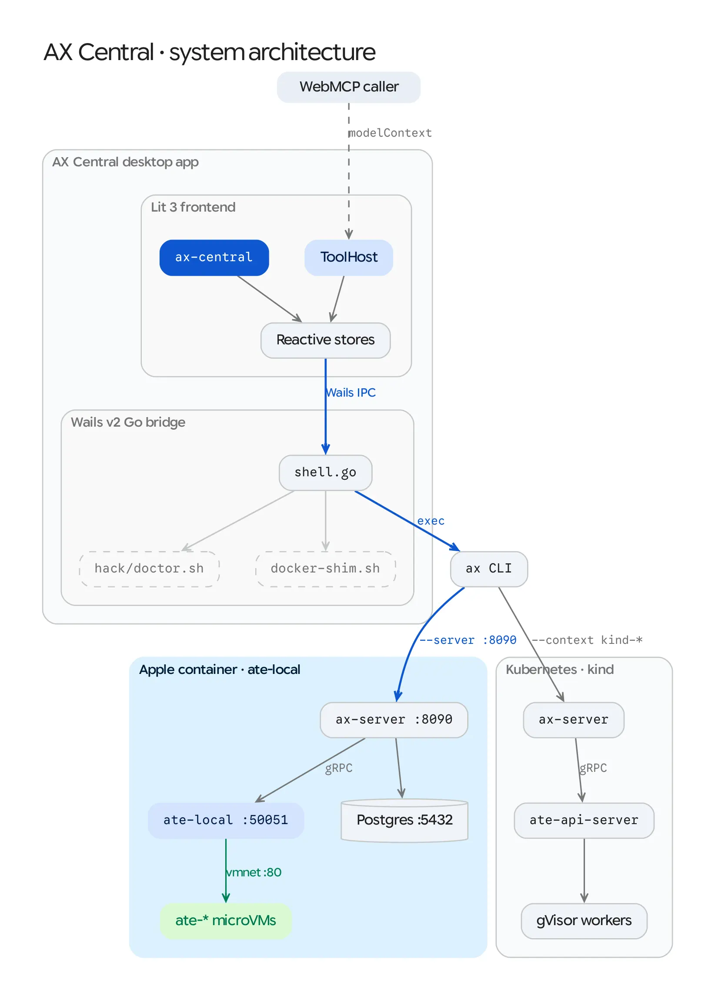

# Explanation: System Architecture and Dual-Substrate Design

AX Central is a cross-platform desktop control plane (macOS, Linux, and Windows) built with **Wails v2** (Go) and **Lit 3 WebComponents** (TypeScript, Luminous 0.15–0.19 design tokens). Inspired by [@rakyll](https://github.com/rakyll)'s proposal in [google/ax#543](https://github.com/google/ax/issues/543) and prototype at [rakyll/ax-studio](https://github.com/rakyll/ax-studio), and developed within the [AX Experiments](https://github.com/ghchinoy/ax-experiments) repository, it connects a single declarative task designer and observability UI to two interchangeable compute substrates: **Apple `container` (`ate-local`)** on macOS and **Agent Substrate on Kubernetes (`kind`)** across macOS, Linux, and Windows.

<picture>
  <source media="(prefers-color-scheme: dark)" srcset="../diagrams/01-architecture-dark.webp">
  
</picture>

## 1. Wails v2 Native Shell and Subprocess Bridge (`shell.go`)

Desktop GUI applications on macOS launch under `launchd` with a minimal environment (`PATH=/usr/bin:/bin:/usr/sbin:/sbin`) that omits Homebrew (`/opt/homebrew/bin`), Go binaries (`~/go/bin`, `/usr/local/go/bin`), and `/usr/local/bin/container`.

To ensure CLI tools behave identically whether AX Central is launched from Finder/Spotlight or a terminal:
1. **Login-Shell `PATH` Discovery (`buildLoginPath`)**: On startup, `shell.go` invokes `$SHELL -ilc 'printf "__AXPATH__%s" "$PATH"'` with a 4-second timeout and merges the result with standard developer directories (`~/go/bin`, `~/.local/bin`, `/opt/homebrew/bin`, `/usr/local/bin`, `/usr/local/go/bin`).
2. **Process-Group Streaming (`Stream` & `Cancel`)**: Long-running scripts (`local-stack.sh up`, `setup-e2e-kind.sh`, `kubectl logs -f`, `container logs -f`) spawn in their own Unix process group (`syscall.SysProcAttr{Setpgid: true}`). When a user clicks **Stop** or switches views, `Cancel` sends `SIGINT` to `-pid`, terminating the entire child pipeline (`make`, `go`, `kind`, `container`, or `kubectl`) rather than orphaning background child processes.
3. **Interactive Sessions (`StartSession`)**: `<ax-terminal-session>` attaches to `ax ssh <task>` over piped `stdin`/`stdout`/`stderr`. The guest script negotiates a full `xterm-256color` PTY via `script(1)` when present in the container image, and falls back to `AXS-LINE-MODE` (with host-side echo, backspace handling, `Ctrl-C` `InterruptSession`, and `Ctrl-D` `EndSessionInput`) on minimal images without `script(1)`.
4. **Shadow DOM Titlebar Dragging (`app.ts`)**: Wails v2's internal drag handler inspects `getComputedStyle(e.target).getPropertyValue("--wails-draggable")` on a `window` bubble-phase `mousedown` listener. Because `<ax-central>` uses a Shadow DOM root, browser event retargeting sets `e.target` to `<ax-central>`. A capture-phase `mousedown` listener on `<ax-central>` inspects `e.composedPath()` (`isTitlebarDragTarget`) and reflects `--wails-draggable: drag | no-drag` onto the host element before the event reaches `window`.

---

## 2. Dual-Substrate Architecture: `ate-local` vs. `kind`

AX decouples its API server (`ax-server`) from low-level container or VM orchestration through the **Agent Substrate Control gRPC API** (`go.ate.dev/substrate/pkg/proto/ateapipb.ControlServer`). AX Central takes advantage of this boundary so developers can iterate locally in seconds and deploy the same resource schemas to Kubernetes:

| Dimension | Local Apple `container` (`ate-local`) | Local Kubernetes (`kind` + Agent Substrate) |
| :--- | :--- | :--- |
| **Control Plane** | `ax-server` (`:8090`) + `ate-local` (`:50051`) + `postgres:17-alpine` (`:5432`) | `ax-server` + `ate-api-server` + `atecontroller` + `ax-postgres` inside `kind` |
| **Sandbox Isolation** | Native macOS Hypervisor Linux `arm64` microVMs (`/usr/local/bin/container`) | Kubernetes pods running inside `gVisor` (`runsc`) worker nodes (`ax-workers`) |
| **Cold Boot Time** | ~3.3s stack startup; ~0.7s task resume | ~10m initial cluster build; pod scheduling + image pull |
| **Network Path** | Direct host routing over macOS `vmnet` bridge (`192.168.64.x:80`) | `kubectl port-forward` tunnels (`~/.ax/tunnels`) + `svc/atenet-router` |
| **Guest Logs** | `container logs -f ate-<atespace>-<actor>` | `kubectl logs -l ate.dev/worker-pool` (JSON structured guest logs) |

### Why `store.scope` Uses `--server` Instead of `--context` for `local`
In `cmd/ax/main.go` (`internal/tunnel/tunnel.go:EnsureServerURL`), passing `--context <name>` instructs `ax` to look up a Kubernetes context in `~/.kube/config` and spawn `kubectl --context <name> port-forward -n ax-system svc/ax-server`. When targeting the `local` (`ate-local`) stack, `store.scope` in `frontend/src/model/store.ts` emits `['--server', 'localhost:8090', '-a', atespace]` and omits `--context`. This routes `ax get`, `ax apply`, `ax resume`, and `ax ssh` directly to the local `ax-server` on `:8090` and makes `<ax-terminal-session>` work without requiring custom environment variables on `SessionRequest`.

---

## 3. Reactive Frontend Stores and Luminous Design Tokens

The frontend avoids framework state libraries in favor of four focused `EventTarget` stores under `frontend/src/model/`:
* **`Store` (`store.ts`)**: Manages active context/atespace scope, polling loop, task/workspace/model collections, activity log, phase sparkline history, and persistent terminal tabs.
* **`DesignerStore` (`designer.ts`)**: Holds draft state for `<ax-designer>`, `.env` parsing, multi-document YAML generation (`Model` + `Workspace` + `Task`), custom YAML tokenizer, and `mcp-auditor` validation checks.
* **`ClustersStore` (`clusters.ts`)**: Probes both the Apple `container` (`ate-local`) stack and `kind` clusters, runs `hack/doctor.sh --json` prerequisite checks, and streams lifecycle commands to the Clusters console.

### Luminous 0.15–0.19 Accessibility Invariants
1. **Atomic Theme Switching**: CSS transitions on buttons and surfaces animate only geometric and elevation properties (`transform`, `box-shadow`, `opacity`) and never `background-color` or `color`. Switching `data-theme="light"` and `data-theme="dark"` updates contrast ratios atomically on the next frame, preventing mid-transition `axe-core` WCAG 2.1 AA contrast failures.
2. **Prettier-Safe YAML Rendering**: Because Lit preserves template whitespace verbatim inside `white-space: pre` containers, `<ax-designer>` styles `.yaml-line` with `display: flex` (which ignores inter-element whitespace nodes per CSS Flexbox §4) and applies `white-space: pre` only to inner `.yaml-tok` spans.
3. **BiDi Prose Isolation**: Technical LTR tokens (`snake_case` tool names, CLI flags, URLs, and resource IDs) inside user-facing prose are wrapped in `<bdi dir="ltr">` (`renderProseWithBdi` in `app.ts`).
