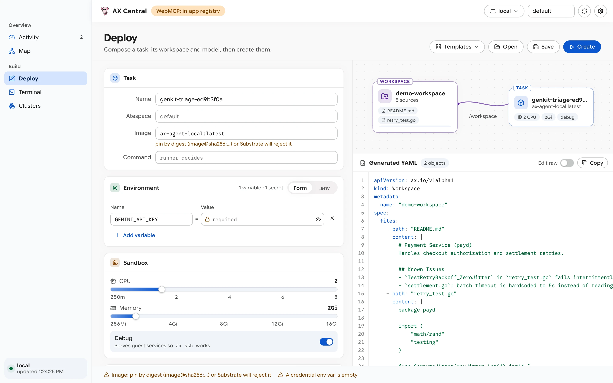
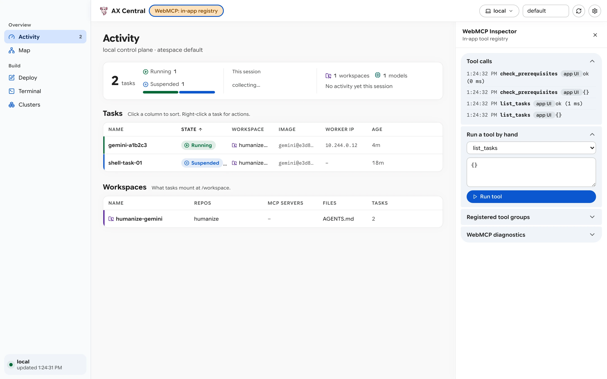

# How-To: Design Tasks and Automate with WebMCP

This guide explains how to compose multi-document AX manifests (`Model`, `Workspace`, and `Task`) in the **Deploy** view (`<ax-designer>`), use the built-in `ax-experiments` templates, and automate AX Central operations through WebMCP (`document.modelContext`).

<picture>
  <source media="(prefers-color-scheme: dark)" srcset="../screenshots/designer-dark.webp">
  
</picture>

## 1. Load a Template in Deploy (`⌘3`)

Open **Deploy** (`⌘3`) and click **Templates** in the top-right toolbar:

| Group | Template Name | Template ID | Description |
| :--- | :--- | :--- | :--- |
| *(Built-in)* | **Blank** | `blank` | Empty task scaffold (`my-task-<id>`). |
| *(Built-in)* | **Shell** | `simple` | Basic `sh -c 'echo $ENVIRONMENT'` task with `ENVIRONMENT=test`. |
| `ax-images` | **Antigravity Agent** | `antigravity` | `ghcr.io/rakyll/ax-images/antigravity` (`v0.5.0`) pinned by digest with `tkem/cachetools` Git workspace and `GEMINI_API_KEY`. |
| `ax-images` | **Gemini Agent** | `gemini` | `ghcr.io/rakyll/ax-images/gemini` (`v0.5.0`) pinned by digest with `tkem/cachetools` Git workspace and `GEMINI_API_KEY`. |
| `ax-images` | **OpenAI Agent** | `openai` | `ghcr.io/rakyll/ax-images/openai` (`v0.5.0`) pinned by digest with `OPENAI_API_KEY`. |
| `ax-images` | **Claude Agent** | `claude-managed-agents` | `ghcr.io/rakyll/ax-images/claude-managed-agents` (`v0.5.0`) pinned by digest with nested `agent: { model, system }` and `ANTHROPIC_API_KEY`. |
| `ax-images` | **GitHub Actions Runner** | `github-actions` | Self-hosted GitHub Actions runner task (`v0.5.0`, `GITHUB_TOKEN`). |
| `ax-experiments` | **Apple Container Task (ate-local)** | `ate-local` | Native `arm64` `debian:12` task for the local Apple `container` stack (`examples/ate_local/task-local.yaml`). |
| `ax-experiments` | **Genkit Incident Triage (ate-local)** | `genkit-apple-container` | Declarative Dotprompt `triage_agent` on `ax-agent-local:latest` bound to `demo-workspace` with `README.md`, `retry_test.go`, `.agents/skills/incident-runbook/SKILL.md`, `tools/incident_mcp.py`, and the `telemetry` STDIO MCP server (`python3 /workspace/tools/incident_mcp.py`). |
| `ax-experiments` | **Swarm Code Reviewer (ate-local)** | `swarm-reviewer` | Security Auditor agent from `~/projects/ax-experiments/swarm/04-review-panel.sh` on `ax-agent-local:latest`. |

---

## 2. Configure Task, Environment, Workspace, and Model

The visual editor on the left side of **Deploy** is divided into six cards that update the **Composition Diagram** and **Generated YAML** in real time:

1. **Task**: Set the RFC 1123 task `Name`, `Atespace`, container `Image`, and `Command` (tokenized into an `argv` array).
2. **Environment**:
   * In **Form** mode, add key-value variables. Keys matching `/KEY|TOKEN|SECRET|PASSWORD/i` are masked with a lock icon and redacted (`••••••••`) in the read-only YAML preview while remaining intact when copied or applied.
   * Paste multiple `export KEY=VALUE` lines into any key input, or switch to **`.env`** mode to edit variables as a block.
3. **Sandbox**: Adjust CPU (`0.25` to `8` cores) and Memory (`256Mi` to `16Gi`) sliders, and keep **Debug** enabled (`spec.debug: true`) so the guest runner exposes port `80` for `ax ssh`.
4. **Runner config**: Choose **Custom YAML** to populate `spec.config` (for example, a declarative Dotprompt agent definition or structured runner parameters).
5. **Workspace**:
   * **None**: Mounts an empty `/workspace`.
   * **Existing**: Binds an existing workspace in the current atespace.
   * **New**: Emits a `kind: Workspace` document alongside the `Task`, including **Git repos**, inline **Files** (such as `AGENTS.md` or `.agents/skills/*/SKILL.md`), and **MCP servers** (HTTP `endpoint` or STDIO `command` + `args`).
   * *Security check (`mcp-auditor`)*: If a STDIO MCP server uses shell wrappers (`sh -c`, `bash -c`) or shell metacharacters, `designer.ts` surfaces a warning in the footer.
6. **Model**: Toggle **Include a Model resource** to emit a `kind: Model` document (`provider`, `model`, `apiKeySecretRef`, `maxTokens`) alongside the `Workspace` and `Task`.

### Switch Between Visual Form and Raw YAML
* Toggle **Edit raw** in the YAML header to edit the multi-document YAML manifest directly inside `<textarea class="yaml-raw">` with a synchronized line-number gutter.
* Use **Open** (`⌘O`) and **Save** (`⌘S`) to load or save `.yaml` manifests on disk (defaulting to `<experimentsPath>` or `<repoPath>/examples`), and click **Create** (`⌘↩`) to apply via `ax apply -f -`.

---

## 3. Automate AX Central via WebMCP (`document.modelContext`)

AX Central registers 17 operational tools with the browser's `document.modelContext` API (when running in a WebMCP-enabled host) and mirrors them in its built-in `ToolHost` registry.

<picture>
  <source media="(prefers-color-scheme: dark)" srcset="../screenshots/webmcp-dark.webp">
  
</picture>

### Interactive Testing in the WebMCP Drawer (`⌘I`)
1. Press **`⌘I`** (or click the **WebMCP** pill in the top toolbar) to open `<ax-webmcp-drawer>`.
2. Use **Run a tool by hand** to pick any registered tool, edit its JSON arguments, and click **Run tool**.
3. Expand **Registered tool groups** to enable or disable entire tool groups (`Tasks`, `Workspaces & Scope`, `Deploy & Clusters`). Disabled groups are immediately unregistered from `document.modelContext`.

### Programmatic Execution from the Console or an Agent

```js
// Example: Load the ate-local template, apply it, and list tasks via ToolHost
const app = document.querySelector("ax-central");
const signal = new AbortController().signal;

await app.host.call("check_prerequisites", {}, signal);
await app.host.call("load_template", { template: "ate-local" }, signal);
await app.host.call("apply_manifest", {}, signal);
const tasks = await app.host.call("list_tasks", {}, signal);
console.log(tasks);
```
