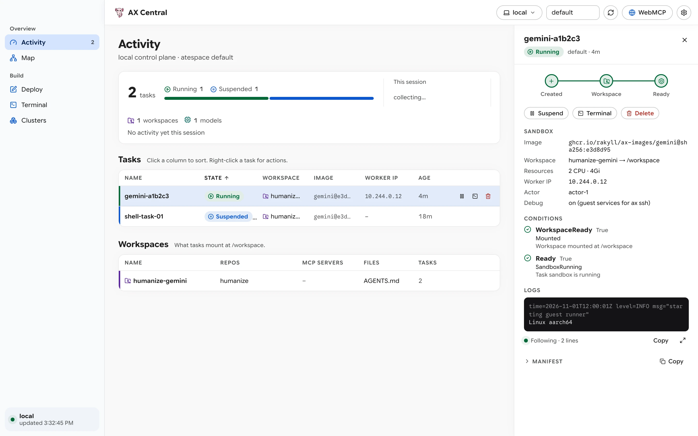

# AX Central Documentation

Welcome to the documentation for **AX Central**, a cross-platform desktop control plane (macOS, Linux, and Windows) for [AX](https://github.com/google/ax) and [Agent Substrate](https://github.com/agent-substrate/substrate).

AX Central is inspired by [@rakyll](https://github.com/rakyll)'s proposal in [google/ax#543](https://github.com/google/ax/issues/543) and prototype at [rakyll/ax-studio](https://github.com/rakyll/ax-studio), and is developed as part of the [AX Experiments](https://github.com/ghchinoy/ax-experiments) suite.

<picture>
  <source media="(prefers-color-scheme: dark)" srcset="screenshots/activity-dark.webp">
  
</picture>

This documentation follows the [Diátaxis](https://diataxis.fr/) structure so you can find the right guide for your current goal:

## 1. Tutorials (Learning-Oriented)

Start here if you are new to AX Central and want a hands-on walkthrough that runs from start to finish on macOS (`ate-local`) or Chromebook / Linux Crostini (`kind-ax-e2e` + `gVisor`):

* **[Run Your First Local Task in AX Central](tutorials/quickstart-local-stack.md)**: Audit prerequisites with `make doctor`, run tasks on either the 3.3-second macOS Apple `container` (`ate-local`) stack or a local Crostini `kind` + Agent Substrate (`gVisor`) cluster, stream guest logs, open an interactive `ax ssh` shell, and invoke tools from the WebMCP Inspector.

## 2. How-To Guides (Task-Oriented)

Step-by-step recipes for specific operational workflows:

* **[Manage Runtimes, Prerequisites, and Clusters](how-to/manage-runtimes-and-clusters.md)**: Run `hack/doctor.sh --install`, manage the Apple `container` (`ate-local`) stack alongside `kind` clusters (with Podman and `docker-shim.sh`), and switch contexts and atespaces.
* **[Design Tasks and Automate with WebMCP](how-to/design-tasks-and-use-webmcp.md)**: Author multi-document `Model`, `Workspace`, and `Task` YAML manifests, load `ax-experiments` templates (`ate-local`, `genkit-apple-container`, `swarm-reviewer`), and drive AX Central programmatically through `document.modelContext`.

## 3. Reference (Information-Oriented)

Factual tables and schemas for lookup while building or scripting:

* **[CLI, Shortcuts, and WebMCP Tools Reference](reference/cli-and-webmcp-tools.md)**: Complete reference for all 16 WebMCP tools, `Makefile` targets, `hack/doctor.sh --json` output schema, and macOS keyboard shortcuts.

## 4. Explanation (Understanding-Oriented)

Architectural context and design trade-offs behind AX Central:

* **[System Architecture and Dual-Substrate Design](explanation/architecture.md)**: How the Wails v2 Go subprocess bridge (`shell.go`), `docker-shim.sh` digest preservation, Lit 3 Luminous design tokens, `TerminalBackend`, and the glidepath between Apple `container` (`ate-local`) and Kubernetes `kind` (`gVisor` WorkerPool) fit together.
