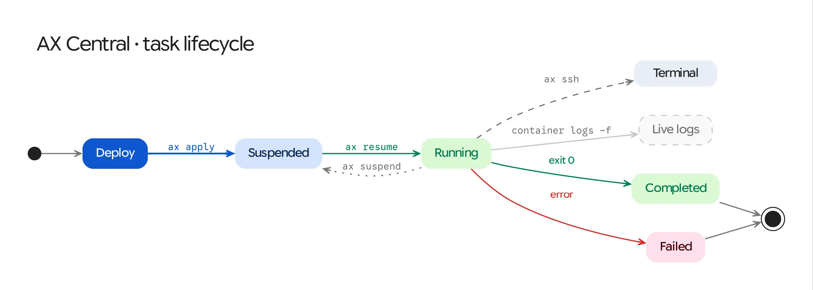
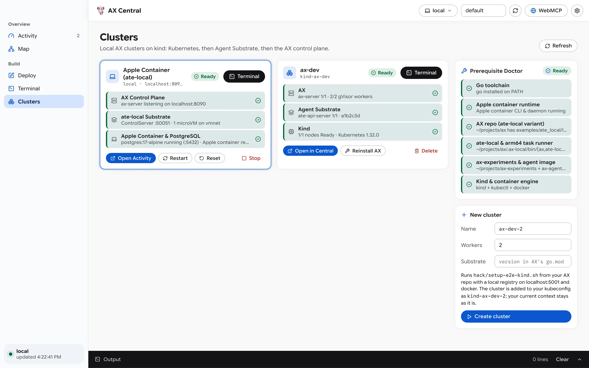
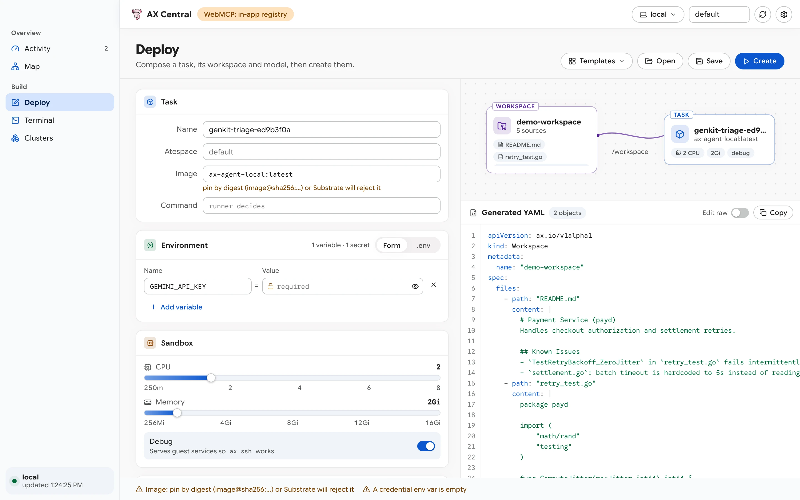
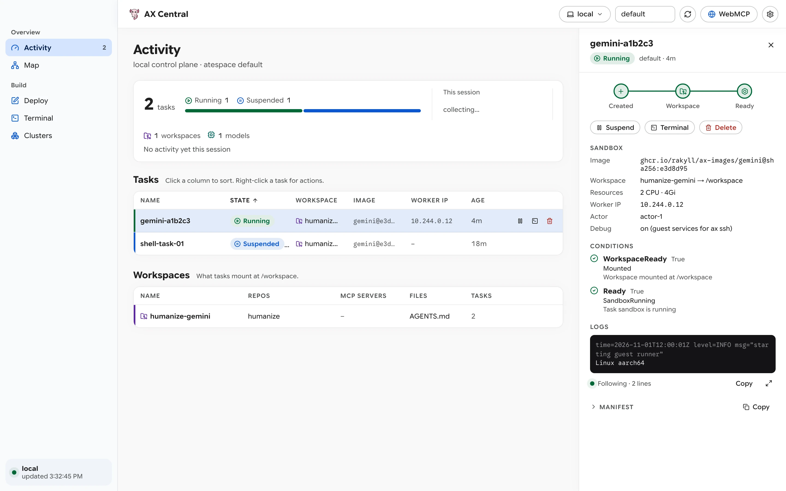
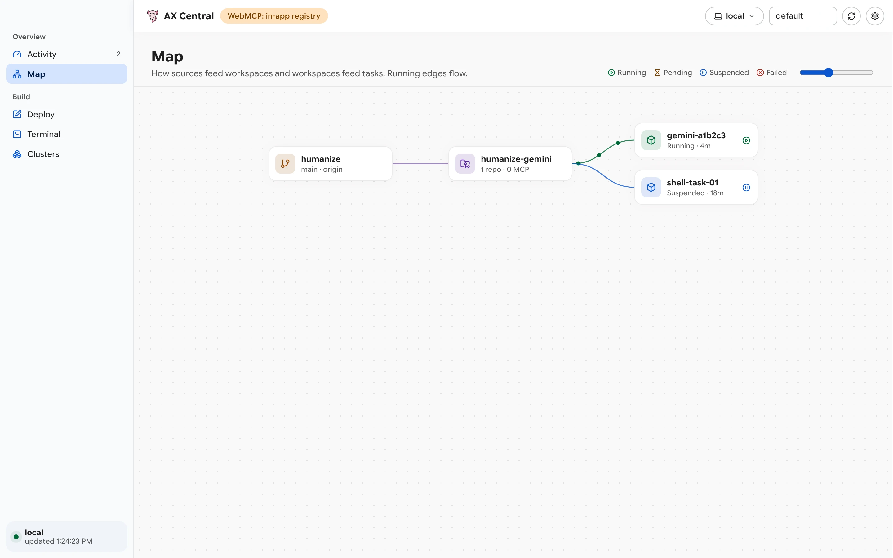
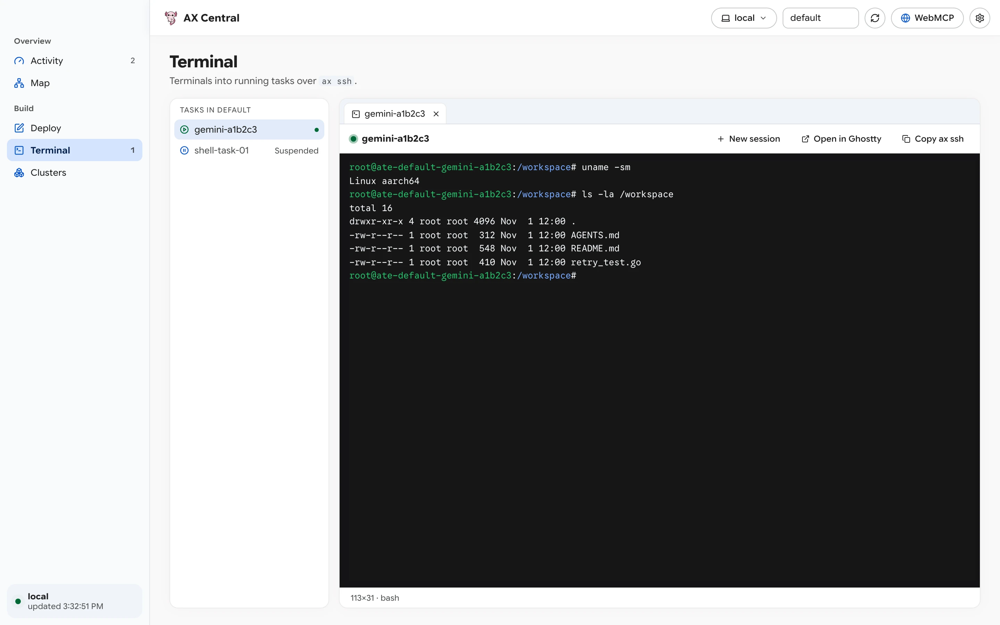
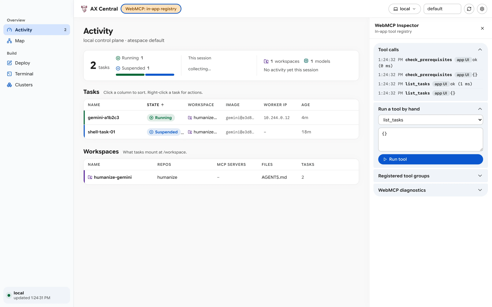

# Tutorial: Run Your First Local Task in AX Central

This tutorial walks through running your first sandboxed task end-to-end in AX Central on either:
* **macOS Apple `container` (`ate-local`)**: Isolated Linux `arm64` microVMs on `vmnet` (`192.168.64.x`).
* **Linux / Chromebook Crostini (`kind` + `gVisor`)**: Full Kubernetes Agent Substrate (`v1.0.0-rc.1+`) with `runsc` `gVisor` sandboxes (`10.244.0.x`), `atenet-router` mTLS ingress, and RustFS volume checkpoints.

Both workflows deploy a task with a workspace, stream live guest logs, open an interactive `ax ssh` shell, and invoke AX tools through the WebMCP Inspector in under two minutes with zero cloud credentials or API keys.

<picture>
  <source media="(prefers-color-scheme: dark)" srcset="../diagrams/02-task-lifecycle-dark.webp">
  
</picture>

## Step 1: Audit Prerequisites and Launch AX Central

From the `ax-central` repository root, run the prerequisite doctor:

```bash
make doctor
```

On an Apple Silicon Mac configured for the local stack, `hack/doctor.sh` reports `ok` across the five Tier-A checks:

```text
  [✓] Go toolchain                     go1.25.5 (/usr/local/go/bin/go)
  [✓] Apple container runtime          /usr/local/bin/container (daemon running)
  [✓] AX repo (ate-local variant)      /Users/you/projects/ax (branch: feat/ate-local-apple-container)
  [✓] ate-local & arm64 task runner    /Users/you/projects/ax/.ax-local/bin ready
  [✓] ax-experiments & agent image     /Users/you/projects/ax-experiments + ax-agent-local:latest
```

If any check reports a warning, run `make bootstrap` to clone the required branches and build `.ax-local/bin/{ax,ate-local,ax-server}` and `.ax-local/bin/linux_arm64/ax-task-runner`.

You can verify the headless stack from your terminal at any time with:

```bash
make smoke-local
```

Next, build and open the native macOS application bundle (or run `make dev` for a live-reloading Wails development session):

```bash
make wails-build && open "build/bin/AX Central.app"
```

> **Window controls:** Grab any empty area on the top toolbar or the top-left sidebar header to drag the window. Double-click the empty toolbar to toggle window zoom.

---

## Step 2: Start the Local Stack in Clusters (`⌘5`)

1. Click **Clusters** in the left sidebar (or press **`⌘5`**).
2. Inspect the **Prerequisite Doctor** card on the right. If any dependency needs repair, click **Bootstrap All** (or the individual **Fix** button) to stream the build in the bottom console.
3. Locate the **Apple Container (`ate-local`)** stack card:
   * If the status badge reads **Stopped**, click **Start**.
   * The bottom **Output** console opens and streams `examples/ate_local/local-stack.sh up`.
   * In about 3.3 seconds, all three layers report green (**Ready**):
     * **AX Control Plane** (`ax-server` listening on `127.0.0.1:8090`)
     * **ate-local Substrate** (`ate-local` gRPC server listening on `127.0.0.1:50051`)
     * **Apple Container & PostgreSQL** (`ax-local-postgres` on `127.0.0.1:5432` and active `ate-*` microVMs)
4. Click **Open in Central** on the card. AX Central sets the active context in the top toolbar to **`local`** and routes `ax` CLI commands to `localhost:8090` using `<repoPath>/.ax-local/bin/ax`.

<picture>
  <source media="(prefers-color-scheme: dark)" srcset="../screenshots/clusters-dark.webp">
  
</picture>

---

## Step 3: Compose and Create a Task in Deploy (`⌘3`)

1. Click **Deploy** in the sidebar (or press **`⌘3`**).
2. Open the **Templates** dropdown in the top-right header. AX Central groups templates into three categories:
   * **Built-in**: `Blank`, `Shell`
   * **`ax-images`**: `Gemini Agent`, `OpenAI Agent`, `Claude Agent`, `GitHub Actions Runner`
   * **`ax-experiments`**: `Apple Container (ate-local)`, `Genkit Triage Agent (Apple Container)`, `Swarm Code Reviewer (04-review-panel)`
3. Choose **`Apple Container (ate-local)`**:
   * In the **Task** section on the left, set **Command** to:
     ```sh
     sh -c 'echo "Hello from microVM: $(uname -sm)" && sleep 300'
     ```
   * In the **Workspace** section, select **New**, keep the workspace name `my-workspace`, and click **Add file** to attach an inline `AGENTS.md` file.
   * Watch the **Composition Diagram** (top-right) render the animated `/workspace` connector between `Workspace` and `Task`, while the **Generated YAML** pane (bottom-right) updates its multi-document manifest.
   * Toggle **Edit raw** in the YAML header to inspect the raw manifest editor with its synchronized line-number gutter, then toggle back to the visual editor.
4. Click **Create** (or press **`⌘↩`**). The footer status bar confirms `task.ax.io/local-task-... created`.

<picture>
  <source media="(prefers-color-scheme: dark)" srcset="../screenshots/designer-dark.webp">
  
</picture>

---

## Step 4: Resume the Task and Stream Logs in Activity (`⌘1`)

1. Click **Activity** in the sidebar (or press **`⌘1`**).
2. Locate your new `local-task-...` entry in the **Tasks** table. New tasks in AX start in the **`Suspended`** phase.
3. Click the **Play (`▶` Resume)** button on the task row (or right-click the row and select **Resume**):
   * `ate-local` boots an isolated Linux `arm64` microVM (`ate-default-local-task-...`) on the macOS `vmnet` bridge (`192.168.64.x`) in roughly 0.7 seconds.
   * Once `/readyz` responds on port `80`, the task phase badge transitions to **`Running`**.
4. Click the task row to open the slide-in **Task Inspector** on the right:
   * **Lifecycle bar**: `Created`, `Workspace`, and `Ready` light up green.
   * **Sandbox fields**: Displays `Image: debian:12`, `Workspace: my-workspace -> /workspace`, `Worker IP: 192.168.64.x`, `Actor`, and `Debug: on`.
   * **Logs (`<ax-task-logs>`)**: Streams live container output via `container logs -f ate-default-local-task-...`. Click the maximize icon in the logs footer to open the full-screen log modal, and press `Esc` to close it.

<picture>
  <source media="(prefers-color-scheme: dark)" srcset="../screenshots/activity-dark.webp">
  
</picture>

---

## Step 5: Explore the Resource Graph in Map (`⌘2`)

1. Click **Map** in the sidebar (or press **`⌘2`**).
2. The SVG Bezier graph illustrates how repository, file, and MCP server sources feed into `my-workspace`, and how `my-workspace` mounts into `local-task-...`.
3. Use the zoom controls in the top-right corner of the canvas, or click any task card in the graph to inspect it.

<picture>
  <source media="(prefers-color-scheme: dark)" srcset="../screenshots/topology-dark.webp">
  
</picture>

---

## Step 6: Open an Interactive Shell in Terminal (`⌘4`)

1. Click **Terminal** in the sidebar (or press **`⌘4`**), or click the **Terminal** action button inside the Task Inspector.
2. In the left **Tasks in default** list, click your running `local-task-...` task.
3. `<ax-terminal-session>` opens an interactive `ax ssh` session directly to the microVM (`192.168.64.x:80`):
   * Run `uname -a`, `ip addr`, or `ls -la /workspace` inside the terminal.
   * Click **New session** to open a second parallel tab to the same task.
   * Click **Open in Ghostty** to launch a native `/Applications/Ghostty.app` window connected to the task over `ax ssh`, or click **Copy ax ssh** to copy the standalone terminal command.

<picture>
  <source media="(prefers-color-scheme: dark)" srcset="../screenshots/terminal-dark.webp">
  
</picture>

---

## Step 7: Call AX Tools via WebMCP (`⌘I`)

1. Click the **`WebMCP: in-app registry`** (or **`WebMCP: document.modelContext`**) badge in the top toolbar (or press **`⌘I`**).
2. The **WebMCP Inspector** drawer opens on the right:
   * **Tool calls**: Displays live invocations, caller identity, arguments, and execution latency.
   * **Run a tool by hand**: Select `list_tasks` or `check_prerequisites` and click **Run tool** to execute the tool and inspect its JSON output.
3. When you finish testing, suspend or delete the task from **Activity** (or via `delete_task` in WebMCP), and click **Stop** on the Apple Container card in **Clusters** (`⌘5`) to shut down the local stack.

<picture>
  <source media="(prefers-color-scheme: dark)" srcset="../screenshots/webmcp-dark.webp">
  
</picture>

---

## Walkthrough B: Running on Chromebook / Linux Crostini (`kind-ax-e2e` + `gVisor`)

When you run AX Central on a Chromebook Linux VM (Crostini / Bagels KVM with Debian 13 `trixie`) or standard Linux workstation provisioned with `~/projects/ax-experiments/crostini/setup-crostini.sh` (or `~/projects/ax/hack/setup-e2e-kind.sh`), AX Central connects to your local `kind` + Agent Substrate (`v1.0.0-rc.1+`) cluster automatically.

### Step 1: Verify the Crostini Environment and Launch AX Central

1. Run the prerequisite auditor from the `ax-central` root:
   ```bash
   make doctor
   ```
   On Crostini, `hack/doctor.sh` verifies Go, Wails + GTK3/WebKit2GTK 4.1, `~/projects/ax` (`setup-e2e-kind.sh` and `.tmp/bin/ax`), `~/projects/ax-experiments/crostini`, and `kind` + `kubectl` + `docker`:
   ```text
     [✓] Go & Wails toolchain             go1.27.1 + wails (/usr/local/bin/wails)
     [✓] Apple container runtime          macOS-only (Linux/Crostini uses Kind + gVisor)
     [✓] AX repo (Kind / Crostini)        /home/you/projects/ax (branch: main, setup-e2e-kind.sh ready)
     [✓] ax CLI & task runner             /home/you/projects/ax/.tmp/bin/ax (or bin/ax) ready
     [✓] ax-experiments & Crostini track  /home/you/projects/ax-experiments/crostini ready
     [✓] Kind & container engine          kind + kubectl + docker
   ```
   *(If Wails or the GTK3/WebKit2GTK development headers are missing on a fresh Crostini container, run `make bootstrap` to install them.)*
2. Optionally run the headless CLI E2E smoke test against `kind-ax-e2e`:
   ```bash
   make smoke-crostini
   ```
3. Start the desktop application in live-reload development mode (or build the native binary with `make wails-build && ./build/bin/ax-central`):
   ```bash
   make dev
   ```
   `Makefile` automatically passes `-tags webkit2_41` on Debian 13 (`trixie`) when `webkit2gtk-4.1` is installed.

### Step 2: Inspect the `ax-e2e` Cluster in Clusters (`Ctrl+5`)

1. On startup, `store.ts` discovers `~/projects/ax/.tmp/bin/ax` and `~/projects/ax/.tmp/kubeconfig-ax-e2e`, and selects **`kind-ax-e2e`** (`ax-e2e` in the top toolbar Context dropdown) as the active context.
2. Press **`Ctrl+5`** to open **Clusters**. The **`ax-e2e`** card displays three green health layers:
   * **AX**: `ax-server 1/1 · 2/2 gVisor workers`
   * **Agent Substrate**: `ate-api-server 2/2 · f86fde9` (`v1.0.0-rc.1`)
   * **Kind**: `1/1 nodes Ready · Kubernetes 1.37.0`
3. If you create or reinstall a cluster from the **New cluster** card on the right, `clusters.ts` automatically exports `SUBSTRATE_IMAGE_CACHE_DIR="$HOME/.cache/substrate-registry"` so warm cluster builds reuse the cached 538 MB Substrate images in under a minute.

### Step 3: Deploy a `gVisor` Task in Deploy (`Ctrl+3`)

1. Press **`Ctrl+3`** to open **Deploy**.
2. Open **Templates** and select **`Shell`** (`simple`):
   * Leave **Image** blank so `ax-server` schedules the cluster's local default runner image (`localhost:5001/ax-task-runner`, which includes the guest HTTP/exec server and metadata proxy).
   * Leave **Command** blank (or enter a custom command) and keep **Debug** toggled **on** (`spec.debug: true`).
   * Under **Workspace**, select **New**, name it `crostini-ws`, and click **Add file** to create `AGENTS.md` with sample instructions.
3. Click **Create** (`Ctrl+Enter`). Once created, click **Resume & Open in Activity** in the top-right header.

### Step 4: Stream `gVisor` Guest Logs and Open an `ax ssh` Terminal (`Ctrl+1` / `Ctrl+4`)

1. In **Activity** (`Ctrl+1`), Agent Substrate allocates a `gVisor` (`runsc`) sandbox on `ax-workers` (`10.244.0.x`), mounts `/workspace`, and transitions the task to **`Running`**.
2. Click the task row to open the **Task Inspector**:
   * **Conditions**: Shows `WorkspaceReady: True (SetupComplete)` and `Ready: True (TaskRunning)`.
   * **Logs**: `<ax-task-logs>` streams the guest container output from `kubectl logs -l ate.dev/worker-pool` using the auto-discovered `KUBECONFIG`.
3. Click **Terminal** in the Task Inspector (or press **`Ctrl+4`**) to open an interactive `ax ssh` tab routed through `atenet-router` mTLS into the `gVisor` sandbox:
   ```sh
   uname -a
   # Linux actor 4.19.0-gvisor #1 SMP ... x86_64 GNU/Linux
   ls -la /workspace
   curl -s "$AX_METADATA_URL/metadata/v1alpha1/ax/task"
   ```
4. Click **Suspend (`⏸`)** on the task row in **Activity** to checkpoint `/workspace` to in-cluster RustFS (`gs://ate-snapshots/ax/`) and release the `gVisor` worker pod.
